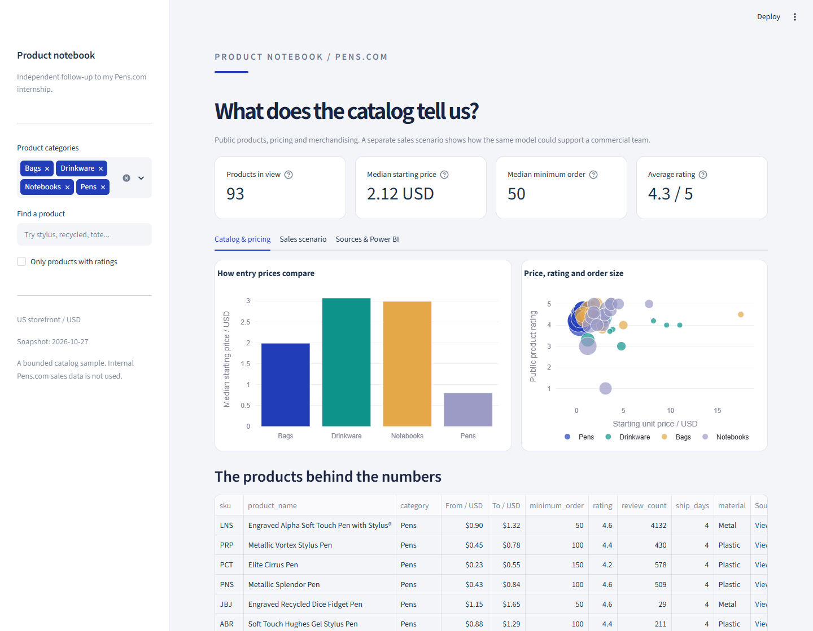

# Pens.com product notebook

A public catalog study inspired by my internship at Pens.com. Browse products, inspect captured quantity-price tiers, or explore a separate sales scenario.

## Run

Python 3.11-3.13:

    python run.py

Open http://localhost:8501. The first run installs the pinned Python dependencies. The React frontend is bundled; Node.js is only needed to edit it.

    python run.py --test
    python run.py --export

Open a product to inspect specifications and a quantity-price subtotal. Price notes compare the observed catalog; Sales model uses clearly labeled fictional transactions.

The snapshot covers 93 products in four US-storefront categories. It is an independent portfolio study, not an internal Pens.com report. All product thumbnails are cached for offline use.

Download the native report from the app, or open powerbi/PensProductNotebook.pbip in Power BI Desktop and select Refresh.

[Setup and dependencies](docs/setup.md) / [API and CSV exports](docs/api.md) / [Sources and calculations](docs/model.md) / [Walkthrough](docs/demo.gif)
